# PocketDesk · 掌上桌面

> 在 STM32F103ZET6 上做的一台"手机"：开机先输 6 位密码解锁，进桌面后左右滑动翻页，
> 上面挂着环境监测卡片、四个小游戏、相机相册、SD 卡文件浏览器和一台双路 DAC 波形发生器。

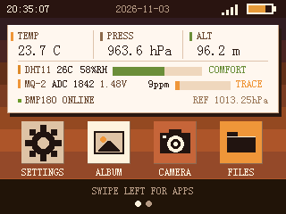

这是一套**裸机 + 阻塞式界面**的实现：没有 RTOS，也没有 GUI 库，所有界面都是直接在
ILI9341 上画点/画线/画块，靠 `while(1)` 里的事件循环和触摸扫描跑起来的。
整个工程约 120 个源文件，其中显示、触摸、SDIO、FatFs、摄像头驱动来自正点原子例程，
桌面 launcher、锁屏、四个小游戏、相册、文件浏览器、DAC 应用是本工程自己写的。

---

## 目录

- [功能一览](#功能一览)
- [界面预览](#界面预览)
- [硬件平台](#硬件平台)
- [引脚分配](#引脚分配)
- [快速开始](#快速开始)
- [操作说明](#操作说明)
- [目录结构](#目录结构)
- [换模块 / 移植：要改哪里](#换模块--移植要改哪里)
  - [一览表](#一览表)
  - [显示器](#1-显示器lcd)
  - [触摸屏](#2-触摸屏)
  - [DHT11 温湿度](#3-dht11-温湿度)
  - [MQ-2 可燃气体](#4-mq-2-可燃气体)
  - [BMP180 气压](#5-bmp180-气压高度)
  - [MAX30102 心率血氧](#6-max30102-心率血氧)
  - [OV7725 摄像头](#7-ov7725-摄像头)
  - [SD 卡](#8-sd-卡)
  - [蜂鸣器 / LED / 按键](#9-蜂鸣器--led--按键)
  - [DAC 波形输出](#10-dac-波形输出)
  - [EEPROM](#11-eepromat24c02)
  - [主频与串口](#12-主频与串口)
  - [只想保留部分功能](#13-只想保留部分功能裁剪)
- [EEPROM 地址分配](#eeprom-地址分配)
- [引脚冲突与踩坑记录](#引脚冲突与踩坑记录)
- [已知限制](#已知限制)
- [第三方代码与致谢](#第三方代码与致谢)

---

## 功能一览

| 模块 | 功能 | 代码位置 |
|---|---|---|
| 锁屏 | 6 位数字密码，默认 `123456`，可改，存 AT24C02；密码页按 WK_UP 可重做触摸校准 | `HARDWARE/GAME/lock.c` |
| 桌面 | 手机风格三页 launcher，左右滑动/按键翻页，图标带加载动画 | `HARDWARE/GAME/menu.c` |
| 状态页 | RTC 时间日期 + DHT11 温湿度 + BMP180 气压/海拔 + MQ-2 浓度等级条 | `menu.c` 内 `draw_sensor_card()` |
| 小游戏 | DINO RUN（跑酷）、PLANE（飞机大战）、SNAKE（贪吃蛇） | `game.c` `plane.c` `snake.c` |
| 心率 | MAX30102 心率 + 血氧，波形/趋势双图 | `heart.c` |
| 相机 | OV7725 全屏实时预览，快门存 320×240 24 位 BMP 到 SD 卡 | `photo.c` |
| 相册 | 列出根目录 `PHxxxx.BMP`，全屏查看、删除 | `photo.c` |
| 文件浏览器 | 浏览 SD 卡任意目录，BMP 可直接看 | `explorer.c` |
| 波形发生器 | PA4/PA5 双路 DAC，正弦/方波/三角/锯齿/噪声，8 档 50 Hz ~ 10 kHz | `dacapp.c` + `HARDWARE/DAC` |
| 设置 | 修改锁屏密码 | `lock.c` 内 `Lock_Settings_Page()` |

## 界面预览

### 桌面系统

| 锁屏（6 位密码，默认 `123456`） | 第一页 · 状态 |
|---|---|
| 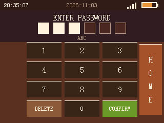 |  |

状态页把四路传感器塞进一张卡片：顶部三个大字是温度 / 气压 / 海拔，下面 DHT11 的温湿度、
MQ-2 的 ADC 原始值与估算浓度、气泡式等级条，底部还有 BMP180 的在线状态和海平面参考气压。

| 第二页 · 应用 | 第三页 · 工具 |
|---|---|
| 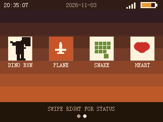 | 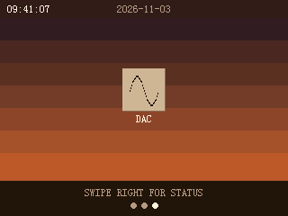 |

三页桌面底部的小圆点表示当前页；左右滑动超过 60 px 翻页，也可以用 KEY1 / KEY2 翻。
第三页目前只挂了 DAC 一个图标，以后加新 APP 就往这一页排。

### 小游戏

| DINO RUN 主页 | DINO RUN 进行中 |
|---|---|
| 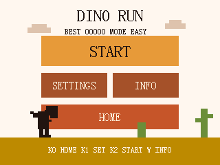 | 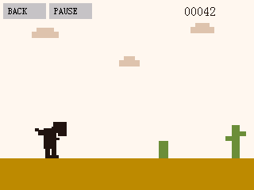 |

| PLANE WAR（飞机大战） | SNAKE（贪吃蛇） |
|---|---|
| 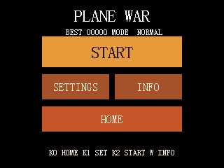 | 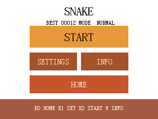 |

三个游戏主页结构一致（`START / SETTINGS / INFO / HOME`），最高分和难度存在 EEPROM 里，
换电池也不会丢。DINO 是点屏起跳，PLANE 是点哪飞哪、自动开火，SNAKE 是左右转。

### 传感器与仪器

| 心率 / 血氧（MAX30102） | DAC 双路波形输出 |
|---|---|
| 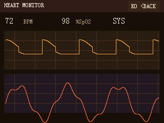 | 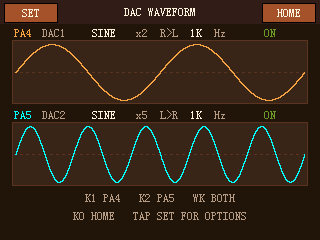 |

DAC 页面上那两条曲线**不是画着看的**：数据直接取自 DMA 源表，屏幕上看到的就是 PA4/PA5
引脚正在输出的采样点，频率、波形、循环次数改一下立刻就能在示波器上对上。

| DAC 设置页 | 文件信息面板 |
|---|---|
| 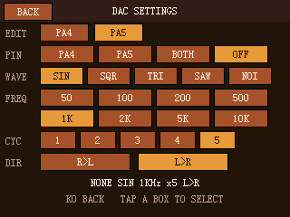 | 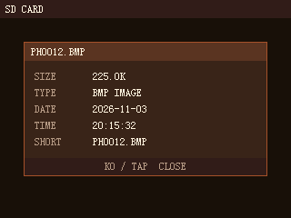 |

设置页可以分别给 PA4 / PA5 选波形（SIN / SQR / TRI / SAW / NOI）、频率（50 Hz ~ 10 kHz 共 8 档）、
循环次数和扫描方向，两路互不影响。

> 以上均为 320×240 界面实图（`docs/screenshots`），配色与布局和 `menu.c` 里的宏一一对应。
> 相机预览、相册列表、文件列表三页需要 SD 卡和实机，没有收录静态图。

## 硬件平台

| 项目 | 型号 |
|---|---|
| 开发板 | 正点原子 战舰 V3（STM32F103ZET6，Cortex-M3 @72 MHz / 512 KB Flash / 64 KB SRAM） |
| 显示屏 | 2.8 寸 TFT，ILI9341，320×240，FSMC 16 位并口 |
| 触摸 | 电容屏 GT9147（也兼容电阻屏 XPT2046/ADS7846） |
| 摄像头 | OV7725 模块（**带 AL422B FIFO**，正点原子摄像头模块） |
| 存储 | SD 卡（SDIO 4 位）+ 板载 AT24C02 EEPROM + W25Q128（本工程未使用） |
| 传感器 | DHT11、MQ-2、BMP180（GY-68）、MAX30102 |
| 其他 | 有源蜂鸣器、4 个按键、2 个 LED、LSE 32.768 kHz 晶振 |

软件栈：**STM32 标准外设库 v3.5 + FatFs R0.10 中文本 + 无 RTOS**。

## 引脚分配

> 这张表是全工程的"接线事实来源"。改硬件时对着这张表改，表格右侧写了对应的宏在哪个文件。

| 模块 | 信号 | MCU 引脚 | 定义位置 |
|---|---|---|---|
| LCD（FSMC 16 位） | D0~D15 | FSMC_D0~D15 | `lcd.c` `LCD_Init()` |
| | RS | FSMC_A10 | `lcd.h` `LCD_BASE`（`0x6C000000 \| 0x7FE`） |
| | CS / WR / RD | FSMC_NE4 / NWE / NOE | `lcd.c` |
| | 背光 BL | **PB0** | `lcd.h` `LCD_LED` |
| 电容触摸 GT9147 | SCL / SDA | **PB1 / PF9** | `ctiic.h` `CT_IIC_SCL/CT_IIC_SDA` |
| 电阻触摸（备选） | PEN / MISO / MOSI / CLK / CS | **PF10 / PB2 / PF9 / PB1 / PF11** | `touch.h` |
| 按键 | KEY0 / KEY1 / KEY2 / WK_UP | **PE4 / PE3 / PE2 / PA0** | `key.h` |
| LED | LED0 / LED1 | **PB5 / PE5** | `led.h` |
| 蜂鸣器 | BEEP | **PB8** | `beep.h` |
| DHT11 | DATA | **PA15**（JTDI，需关 JTAG） | `DHT11.h` |
| MQ-2 | AO → ADC1_IN6 | **PA6** | `mq2.h` |
| BMP180 | SCL / SDA | **PB7 / PB6** | `bmp180.c` `scl_pin/sda_pin` |
| MAX30102 | SCL / SDA / INT | **PE1 / PE0 / PE6** | `max30102.h` |
| OV7725 | D0~D7 | **PC0~PC7** | `ov7725.h` `OV7725_DATA` |
| | VSYNC / WRST / WREN / RCK / RRST / CS | **PA8 / PD6 / PB3 / PB4 / PG14 / PG15** | `ov7725.h` |
| | SCCB SCL / SDA | **PD3 / PG13** | `sccb.h` |
| SD 卡（SDIO） | D0~D3 / CLK / CMD | **PC8~PC11 / PC12 / PD2** | `sdio_sdcard.c` |
| EEPROM AT24C02 | SCL / SDA | **PB10 / PB11**（软件 IIC） | `myiic.h` |
| SPI Flash W25Q128 | CS（SPI2） | PB12（**未使用**） | `w25qxx.h` |
| DAC 波形输出 | DAC1 / DAC2 | **PA4 / PA5** | `dac.h` |
| 串口 1 | TX / RX | PA9 / PA10，115200 | `usart.c` |
| 调试 | SWDIO / SWCLK | PA13 / PA14 | — |

## 快速开始

### 1. 编译环境

- **Keil MDK 5**（UV5）+ **ARM Compiler 5（AC5）**，需要装好 `Keil.STM32F1xx_DFP` 器件包。
  AC6 也能编过，但标准外设库在 AC6 下会刷一屏告警，建议直接用 AC5。
- 目标配置（已存在工程里，一般不用改）：
  - Device：`STM32F103ZE`
  - Define：`STM32F10X_HD, USE_STDPERIPH_DRIVER`
  - IROM `0x08000000` / 0x80000，IRAM `0x20000000` / 0x10000，晶振 12 MHz（调试器配置项，实际时钟见下文）

### 2. 编译

用 Keil 打开 `USER/TOUCH.uvprojx`，直接 **Build**（F7）。工程共 7 个分组：
`USER / HARDWARE / GAME / SYSTEM / CORE / FWLib / FATFS`。

> `HARDWARE/USMART`、`HARDWARE/W25QXX`、`HARDWARE/SPI`、`FATFS/exfuns` 这些目录里虽然有代码，
> 但**没有参与编译**（`w25qxx.c` / `spi.c` 在 target 里但没人调用），可以放心忽略。

### 3. 烧写

J-Link 或 ST-Link 走 SWD 下载即可，无需额外接线（PA15 被 DHT11 占用后 JTAG 已关闭，SWD 照常可用）。

### 4. 首次上电

1. 会先做一次**横屏触摸校准**（`game.c` 的 `Touch_Cal_Check()` 会清掉旧标志，`tp_dev.init()` 自动进校准），
   按屏幕提示点 4 个十字点；校准值写 EEPROM 40~54，标志位写 60 = `0x5A`。
   之后每次开机不再校准，想重校：**在密码界面按一下 WK_UP**（最省事，不用拆机、不用擦 EEPROM），
   或者按住 KEY0，或者擦掉 EEPROM 第 60 字节。
2. 进锁屏，输入默认密码 **`123456`** → `CONFIRM`。
3. 进桌面。状态栏时间是 RTC，**首次上电的初始值取自编译时的 `__DATE__` / `__TIME__`**，
   所以会显示成"你编译的那一刻"；之后靠 LSE + 纽扣电池走时。

### 5. SD 卡（相机 / 相册 / 文件浏览器需要）

- FAT32 格式化，插板载 SD 卡槽（SDIO，不是 SPI 模式）。
- 照片固定写成根目录 `PH0001.BMP` ~ `PH9999.BMP`，320×240、24 位、未压缩 BMP。
- 没有卡也能开机，只是这三个 APP 会提示 `SD INIT ERR` / `MOUNT ERR`。

## 操作说明

| 场景 | KEY0 (PE4) | KEY1 (PE3) | KEY2 (PE2) | WK_UP (PA0) | 触摸 |
|---|---|---|---|---|---|
| 锁屏 | 数字 0 | — | — | 重做触摸校准 | 屏幕键盘 |
| 桌面 | 回锁屏 | 下一页 | 上一页 | 直接开相机 | 点图标 / 左右滑动翻页 |
| 游戏菜单 | 开始 | 设置 | 返回桌面 | 说明页 | 点按钮 |
| DINO RUN | 跳 | 跳 | 返回 | 暂停/继续 | 点屏幕跳 |
| PLANE | 按住左移 | 按住右移 | 返回 | 暂停 | 点哪飞哪，自动开火 |
| SNAKE | 左转 | 右转 | 返回 | 暂停 | 点棋盘左/右半转向 |
| 心率 / 相机 / 相册 / 文件 | 返回 | 翻页/下移 | 翻页/上移 | 打开/快门 | 界面按钮 |
| DAC | 切 PA4 开关 | 切 PA5 开关 | 回桌面 | 两路一起开关 | `SET` 进设置页 |

## 目录结构

```
.
├── USER/                  # main.c、工程文件、启动文件、中断向量
│   ├── main.c             # 系统初始化 + 进入 Main_Menu()
│   └── TOUCH.uvprojx      # Keil 工程（打开这个）
├── HARDWARE/
│   ├── LCD/ TOUCH/        # ILI9341 + 触摸（FSMC / IIC）
│   ├── SDIO/ FATFS 驱动   # SD 卡底层
│   ├── OV7725/ SCCB/      # 摄像头 + FIFO 读时序
│   ├── DHT11/ MQ-2/ BMP180/ MAX30102/ ADC/   # 传感器
│   ├── DAC/               # 双路 DAC + DMA + TIM6/7
│   ├── 24CXX/ IIC/ W25QXX/ SPI/
│   ├── KEY/ LED/ BEEP/
│   └── GAME/              # ← 本工程的应用层（重点看这里）
│       ├── menu.c         # 三页桌面 launcher（约 1600 行，最大的文件）
│       ├── lock.c         # 锁屏 + 改密码
│       ├── game.c         # DINO RUN + 难度/最高分存储
│       ├── plane.c        # 飞机大战
│       ├── snake.c        # 贪吃蛇
│       ├── heart.c        # 心率血氧页
│       ├── photo.c        # 相机 + 相册
│       ├── explorer.c     # 文件浏览器
│       ├── dacapp.c       # DAC 波形应用
│       └── ui.c           # 小游戏共用的按钮/面板原语
├── FATFS/src/             # FatFs R0.10（_CODE_PAGE 936 GBK）
├── SYSTEM/                # delay / sys / usart
├── CORE/                  # CMSIS
├── STM32F10x_FWLib/       # 标准外设库 v3.5
├── MALLOC/                # 内部 SRAM 内存池
└── docs/screenshots/      # README 用的界面图
```

---

## 换模块 / 移植：要改哪里

### 一览表

| 你要换的东西 | 改这个文件 | 改哪个宏 / 函数 | 还要注意 |
|---|---|---|---|
| 显示屏 | `HARDWARE/LCD/lcd.h`、`lcd.c` | `LCD_LED`、`LCD_BASE`、`LCD_Init()` 里 FSMC 时序 | 分辨率一变，所有 UI 坐标都要跟着改（见 1） |
| 触摸屏 | `TOUCH/touch.h`（电阻）、`TOUCH/ctiic.h`（电容） | `PEN/DOUT/TDIN/TCLK/TCS` 或 `CT_IIC_SCL/CT_IIC_SDA` | 换完必须重做校准 |
| DHT11 | `DHT11/DHT11.h` | `DHT11_GPIO_PORT/PIN/CLK` | 别接 PB0；PA15 需关 JTAG |
| MQ-2 | `MQ-2/mq2.h` | `MQ2_AO_GPIO_PORT/PIN/CLK`、`MQ2_ADC_CHANNEL`、`MQ2_TH_*_MV` | AO 电压必须 ≤3.3 V |
| BMP180 | `BMP180/bmp180.c` | `scl_pin` / `sda_pin` 两个静态变量 | 只支持 GPIOB |
| MAX30102 | `MAX30102/max30102.h` | `MAX30102_IIC_*`、`MAX30102_INT_*` | 换 MAX30100 要改寄存器序列 |
| 摄像头 | `OV7725/ov7725.h`、`sccb.h` | `OV7725_DATA`、VSYNC/WRST/WREN/RCK/RRST/CS | 必须是带 FIFO 的模块 |
| SD 卡 | `SDIO/sdio_sdcard.c`、`FATFS/src/diskio.c` | SDIO 引脚初始化 / `disk_*` 四个函数 | 换 SPI 模式卡要重写 diskio |
| 蜂鸣器 | `BEEP/beep.h`、`beep.c` | `BEEP_ACTIVE_HIGH`、`BEEP_PASSIVE` | 无源蜂鸣器要方波驱动 |
| 按键 | `KEY/key.h`、`key.c` | `KEY0/KEY1/KEY2/WK_UP` | WK_UP 是高电平有效 |
| LED | `LED/led.h` | `LED0/LED1` | — |
| DAC | `DAC/dac.h` | 波形表、`DAC_FREQ_LEVELS` | 通道只能 PA4/PA5 |
| EEPROM | `24CXX/24cxx.h`、`IIC/myiic.h` | `EE_TYPE`、`IIC_SCL/IIC_SDA` | 换大容量芯片地址会变 |
| 主频 | `USER/system_stm32f10x.c` | `PLL` / `HSE_VALUE` | 8 MHz 与 12 MHz 晶振不同 |

下面逐项展开。

### 1. 显示器（LCD）

**换驱动 IC（同尺寸、同接口）**：不用改代码。`lcd.c` 的 `LCD_Init()` 会读 ID 自动识别，
支持 ILI9341 / NT35310 / NT35510 / SSD1963 / ST7789 / ST7796 / ILI9806。识别到之后按 `lcddev.id` 走不同分支。

**换背光引脚**：`lcd.h`

```c
#define LCD_LED PBout(0)   // 板载背光是 PB0，高电平点亮
```

**换 FSMC 片选/地址线**（换板子必改）：`lcd.h`

```c
#define LCD_BASE ((u32)(0x6C000000 | 0x000007FE))
```

`0x6C000000` = FSMC Bank1 NOR/SRAM 第 4 区（NE4），`0x7FE` 表示 RS 接在 `FSMC_A10`。
你的板子要是用 NE1 + A16，就改成 `0xA0000000 | 0x1FFFE` 这一类，同时 `lcd.c` 里 FSMC 的
`FSMC_BCR/FSMC_BTR` 时序参数（读写建立/保持时间）要按你的屏重新配。

**换分辨率（最容易翻车的一项）**：
`lcddev.width/height` 由驱动按 ID 自动设，但**本工程所有界面坐标都是按 320×240 横屏硬编码的**。
换分辨率要动这些地方：

| 文件 | 要改的宏 / 函数 |
|---|---|
| `menu.c` | `BAR_H` `DOCK_Y` `ICON_SZ` `APP_*_X/Y` `CARD_*` 一系列布局宏 |
| `ui.c` | 按钮坐标 `HP_BTN_X/W/Y`、`HP_LABEL_Y`（小游戏共用） |
| `game.c` `plane.c` `snake.c` `heart.c` | 各自的地面/天空/棋盘格子尺寸 |
| `photo.c` | `IMG_W` / `IMG_H`（照片尺寸，和屏一致最省事） |
| `dacapp.c` | 两个示波器框的坐标系 |

方向由 `main.c` 的 `LCD_Display_Dir(1)` 决定（1 = 横屏）。改成竖屏的话 `0/1` 参数要换，
而且触摸坐标映射也会跟着变（`tp_dev.touchtype` 的 bit0）。

### 2. 触摸屏

触摸驱动是**自动探测**的：`touch.c` 的 `tp_dev.init()` 里依次尝试 GT9147 → OTT2001A → FT5206，
都不成功就回落到电阻屏（`TP_Init()`），最后把函数指针挂到 `tp_dev.scan`。

**电容屏**（本工程用的）：只改 `TOUCH/ctiic.h` 两行

```c
#define CT_IIC_SCL    PBout(1)   // SCL
#define CT_IIC_SDA    PFout(9)   // SDA
```

**电阻屏**：改 `TOUCH/touch.h` 里注释掉的那组宏

```c
#define PEN    PFin(10)   // 触摸中断
#define DOUT   PBin(2)    // MISO
#define TDIN   PFout(9)   // MOSI
#define TCLK   PBout(1)   // SCLK
#define TCS    PFout(11)  // CS
```

**换了触摸 IC 型号**：在 `gt9147.c` / `ft5206.c` 里改 IIC 从机地址和初始化寄存器表；
如果新 IC 不在上面三家之列，照着 `ft5206.c` 加一对 `XXX_Init()` / `XXX_Scan()`，再在
`tp_dev.init()` 里加一个探测分支即可。

**换完屏/触摸一定要重做校准**：最方便的是开机进到密码界面，按一下 **WK_UP**——
屏幕先显示 `CALIBRATING TOUCH...`，然后进白底红十字校准，点完 4 个点自动写回 EEPROM 40~54
并重画回密码界面（手指松开会当成一次点击，所以 `lock.c` 里把 `tp_last` 清了零）。
这个入口就是给"触摸偏到点不中键盘、进不了桌面"准备的；也可以擦掉 EEPROM 第 60 字节
（`0x5A` 标志），或者把 `game.c` 里 `Touch_Cal_Check()` 的早退条件临时去掉，让下次开机会强制进校准。

### 3. DHT11 温湿度

`HARDWARE/DHT11/DHT11.h`，三个宏：

```c
#define DHT11_GPIO_PORT     GPIOA
#define DHT11_GPIO_PIN      GPIO_Pin_15
#define DHT11_GPIO_CLK      RCC_APB2Periph_GPIOA
```

注意事项（都在头文件注释里写了，这里重复一遍）：

- **别接 PB0**：PB0 是 LCD 背光。DHT11 每次通信要拉低数据线 18 ms 发起始信号，
  接 PB0 会表现为"桌面每 2 秒整屏闪一下"。
- **PA15 是 JTDI**：`DHT11_Init()` 里已经调了 `GPIO_Remap_SWJ_JTAGDisable`，
  关掉 JTAG 但保留 SWD，所以下载调试不受影响。换成别的 JTAG 引脚时记得搬这段。
- 换引脚后要保证外部有 4.7 k~10 k 上拉到 3.3 V（模块一般自带）。

**换成 DHT22 / AM2302**：接口一样但协议不同（40 bit，湿度 16 位 + 温度 16 位带小数）。
改 `DHT11.c` 里 `DHT11_Read_Data()` 的解析部分，同时 `menu.c` 里显示卡片取的是
`u8` 温湿度，要改成 `float` 或 `×10` 的定点数。

### 4. MQ-2 可燃气体

`HARDWARE/MQ-2/mq2.h`：

```c
#define MQ2_AO_GPIO_PORT    GPIOA
#define MQ2_AO_GPIO_PIN     GPIO_Pin_6
#define MQ2_AO_GPIO_CLK     RCC_APB2Periph_GPIOA
#define MQ2_ADC_CHANNEL     ADC_Channel_6   /* PA6 = ADC1_IN6 */
```

- 模块 **VCC 必须 5 V**（加热丝），3.3 V 供电浓度会偏低。
- 5 V 供电时 **AO 一定要分压到 ≤3.3 V** 再进 PA6，否则会打坏 ADC 脚。
- 换引脚时 `MQ2_ADC_CHANNEL` 要和 `GPIO_Pin` 对应（`ADC_Channel_n` ↔ `PA n`），
  并且别用已经被占的 ADC 通道。
- **换模块（MQ-135 / MQ-7 / MQ-9）**：接口完全一样，改这三组数就行：

```c
#define MQ2_TH_TRACE_MV     900    // 洁净空气基线 ×2~3
#define MQ2_TH_ALARM_MV     1600
#define MQ2_TH_DANGER_MV    2400
#define MQ2_R0              6.64f  // 洁净空气中的 Rs（kΩ），必须重标
#define MQ2_PPM_A           11.5428f
#define MQ2_PPM_B           0.6549f
```

标定方法：上电预热 3~5 分钟，读洁净空气里的 AO 电压作为基线，再按倍数设阈值。
`ppm` 只能当相对趋势看，别当精确值。

### 5. BMP180 气压/高度

引脚在 `bmp180.c` 的两个静态变量里，不在头文件：

```c
static uint16_t scl_pin = GPIO_Pin_7;   /* SCL = PB7 */
static uint16_t sda_pin = GPIO_Pin_6;   /* SDA = PB6 */
```

驱动开机时会**先试 SCL=PB7/SDA=PB6，再试反接**，所以 SCL/SDA 接反了也能自动纠正
（诊断信息看 `BMP180_PinSwapped`）。只支持 GPIOB，换到别的端口要把宏里的 `GPIOB` 一起改。

精度相关的三个宏：`BMP180_OSS`（过采样 0~3）、`BMP180_FILTER`（软件低通权重）、
`BMP180_SEA_LEVEL_PA`（算海拔用的海平面气压，本地气压差 10 hPa 海拔会差约 80 m）。

> 注意：芯片 ID 寄存器里如果读到 `0x58` 说明装的是 BMP280，**引脚兼容但寄存器/补偿算法不同**，
> 本驱动只实现了 BMP180 的补偿公式，BMP280 需要另外移植 Bosch 的算法。

### 6. MAX30102 心率血氧

`HARDWARE/MAX30102/max30102.h`：

```c
#define MAX30102_IIC_PORT       GPIOE
#define MAX30102_IIC_SCL_PIN    GPIO_Pin_1
#define MAX30102_IIC_SDA_PIN    GPIO_Pin_0
#define MAX30102_INT_PORT       GPIOE
#define MAX30102_INT_PIN        GPIO_Pin_6
```

- SCL/SDA 需 **4.7 k 上拉到 3.3 V**。
- INT 脚本工程**不用**（轮询 FIFO），可以不接；但别接到 PB9（板载红外接收头输出），两个输出顶一起会灌电流。
- 换到别的 IIC 口：改上面 5 个宏 + `MAX30102_IIC_CLK` 时钟宏。
- **换 MAX30100**：寄存器地址和 FIFO 格式都不一样，要重写 `max30102.c` 的初始化序列，
  以及 `heart.c` 里读 FIFO 的解析（每样本字节数从 3×2 变成 2×2）。
- 心率算法在 `heart.c`（4 点移动平均 + 峰值检测 + 5 点中值滤波），不是 Maxim 官方的 HR 算法。

### 7. OV7725 摄像头

`HARDWARE/OV7725/ov7725.h`：

```c
#define OV7725_VSYNC   PAin(8)     // 场同步
#define OV7725_WRST    PDout(6)    // FIFO 写指针复位
#define OV7725_WREN    PBout(3)    // FIFO 写使能
#define OV7725_RCK_H/L GPIOB->BSRR/BRR (1<<4)  // FIFO 读时钟 PB4
#define OV7725_RRST    PGout(14)   // FIFO 读指针复位
#define OV7725_CS      PGout(15)   // FIFO 片选(OE)
#define OV7725_DATA    GPIO_ReadInputData(GPIOC,0x00FF)  // PC0~PC7
```

SCCB（配置接口）在 `HARDWARE/OV7725/sccb.h`：SCL = PD3，SDA = PG13。

- **必须是带 AL422B FIFO 的模块**（正点原子那种）。没有 FIFO 的裸 OV7725 模块没法用这套读时序，
  只能改成 DCMI（F103 没有 DCMI）或降帧率直读，不建议。
- 数据口改了 8 位宽度以外的端口，`OV7725_DATA` 那行掩码要跟着改成对应该端口的位掩码。
- **换 OV7670**：`OV7725_Init()` 里的 PID 检查（`0x7721`）要改成 `0x7673`，
  寄存器表换成 `ov7670cfg.h`，并去掉 7725 特有的寄存器（如 `0x0C` 的注释区）。

### 8. SD 卡

- 本工程走 **SDIO 4 位模式**，引脚固定死在 PC8~PC11（D0~D3）、PC12（CLK）、PD2（CMD），
  换个板子只要引脚不同就得改 `sdio_sdcard.c` 里 `SD_LowLevel_Init()` 的 GPIO 初始化。
- 如果你只有 **SPI 模式的卡座**：不用改上层，只重写 `FATFS/src/diskio.c` 里
  `disk_initialize` / `disk_status` / `disk_read` / `disk_write` / `disk_ioctl` 五个函数，
  FatFs 和相册/浏览器代码一行都不用动。
- FatFs 配置在 `FATFS/src/ffconf.h`：`_CODE_PAGE 936`（GBK，支持中文长文件名）、
  `_VOLUMES 2`、`_FS_READONLY 0`。
- **注意 `f_mount` 只能有一个实例**：`photo.c` 提供 `SD_Mount()`，`explorer.c` 复用它，
  不要各模块自己 `f_mount`，否则会互相顶掉（这是本工程踩过的坑）。
- 照片尺寸改 `photo.c` 的 `IMG_W/IMG_H`；BMP 行字节数 `IMG_W*3` 必须 4 字节对齐，
  320×240 刚好是 960 字节，改尺寸要重新算 `ROW_BYTES`。

### 9. 蜂鸣器 / LED / 按键

**蜂鸣器** `beep.h` 两个宏搞定，换引脚才需要动 `beep.c`：

```c
#define BEEP_ACTIVE_HIGH  1   // 1 = 高电平响（默认）；0 = 低电平响
#define BEEP_PASSIVE      0   // 1 = 无源蜂鸣器（改用方波驱动）
```

**按键** `key.h` 改 `KEY0/KEY1/KEY2/WK_UP` 四个宏 + `key.c` 里 `KEY_Init()` 的 GPIO 初始化。
KEY0/1/2 是**按下接 GND（低有效）**，WK_UP 是**接 VCC（高有效）**，接反了要改扫描逻辑。

**LED** `led.h`：`#define LED0 PBout(5)` / `LED1 PEout(5)`。只做状态指示，不参与功能。

### 10. DAC 波形输出

硬件通道是固定的，**只有 PA4（DAC1）和 PA5（DAC2）**，换不了引脚：

| 通道 | 引脚 | DMA | 触发定时器 |
|---|---|---|---|
| DAC1 | PA4 | DMA1_Channel3 | TIM6_TRGO |
| DAC2 | PA5 | DMA1_Channel4 | TIM7_TRGO |

两路共用一张 **64 点波形表**，DMA 循环搬运，定时器更新率决定频率。
要改波形种类 / 频率档位，改 `HARDWARE/DAC/dac.h` 和 `dac.c`：

```c
#define DAC_FREQ_LEVELS 8     // 频率档数（50 Hz ~ 10 kHz）
```

> 想让两路输出不同波形，得各建一张表并改 `dac.c` 里的 DMA 源地址，现在的实现是共用一张。
> 另外 PA4/PA5 输出没有缓冲运放，带负载能力很弱，接耳机/喇叭要加运放。

### 11. EEPROM（AT24C02）

`HARDWARE/IIC/myiic.h`（软件 IIC，不是硬件 I2C）：

```c
#define IIC_SCL    PBout(10)
#define IIC_SDA    PBout(11)
```

容量型号在 `24cxx.h`：

```c
#define EE_TYPE AT24C02     // 换成 24C64 就改成 AT24C64
```

换成 AT24C32 以上要注意 **16 位地址**，`24cxx.c` 里已经用 `EE_TYPE > AT24C16` 做了分支。
**换芯片后本工程存在里面的数据（校准、密码、最高分）都会变成无效值**，程序有默认值兜底，
但密码会回到 `123456`，触摸要重校。

### 12. 主频与串口

- 时钟：`USER/system_stm32f10x.c`，默认 **HSE 8 MHz → PLL ×9 → 72 MHz**。
  如果你的板子是 12 MHz 晶振，改 `stm32f10x.h` 里的 `HSE_VALUE` 和 PLL 倍频（×6）。
  改错了表现为串口乱码、LCD 花屏、SD 卡初始化失败。
- 串口：`SYSTEM/usart/usart.c`，USART1 PA9/PA10，115200 8N1。
  目前只用于调试打印，`USART_RX_BUF` 有中断接收但没接业务。
- 延时：`SYSTEM/delay` 用 SysTick，**不要在其他地方再改 SysTick 重装载值**。

### 13. 只想保留部分功能（裁剪）

| 目标 | 做法 |
|---|---|
| 只想要某个游戏 | `main.c` 里把 `Main_Menu()` 换成 `Game_Menu()` / `Plane_Menu()` / `Snake_Menu()` |
| 只想要相机 | `main.c` 里把 `Main_Menu()` 换成 `Camera_Run()` |
| 不要桌面里的某个 APP | `menu.c` 里删掉对应图标绘制（`draw_app_xxx`）+ 点击判定分支 + include；不删也只是多占几 KB Flash |
| 不要状态页的传感器卡片 | `menu.c` 的 `draw_sensor_card()` / `sensor_refresh()` 直接不调用；驱动文件仍会编译，可在 target 里移除 `DHT11.c` `mq2.c` `bmp180.c` |
| 不要锁屏 | `menu.c` 的 `Main_Menu()` 里去掉 `Lock_Init()` / `Lock_Run()` 两行 |
| 不要 SD 相关 | 从 target 移除 `sdio_sdcard.c`、`ff.c`、`fat_cc.c`，并去掉 `photo.c` / `explorer.c` |
| 减小体积 | 移除 `w25qxx.c`、`spi.c`、`usart` 的接收中断、`MALLOC`（如果不用动态内存） |

---

## EEPROM 地址分配

AT24C02 = 256 字节，本工程用了这些位置（**改功能时别撞车**）：

| 地址 | 用途 | 写入者 |
|---|---|---|
| 40 ~ 54 | 触摸校准参数 | `touch.c` `TP_Adjust()` |
| 54 | 触摸校准标志 | `touch.c` |
| 60 | `0x5A` = 已完成**横屏**校准 | `game.c` `EE_TOUCH_FLAG` |
| 61 | DINO RUN 难度 0/1/2 | `game.c` `EE_DIFF` |
| 62 ~ 63 | DINO RUN 最高分（u16 大端） | `game.c` `EE_BEST` |
| 64 ~ 65 | PLANE 最高分 | `plane.c` `EE_BEST_PLANE` |
| 66 ~ 67 | SNAKE 最高分 | `snake.c` `EE_BEST_SNAKE` |
| 128 | `0xA6` = 密码有效标志 | `lock.c` `EE_PWD_MAGIC` |
| 129 ~ 134 | 6 位密码（ASCII） | `lock.c` `EE_PWD_BASE` |
| 255 | `0x55` = 24C02 自检标志 | `24cxx.c` |

> 加新东西存 EEPROM，请从 **68~127** 这段空白里找地址，别占 40~67 和 128~134。

## 引脚冲突与踩坑记录

这些是移植时最容易撞车的点，都是实际调试踩出来的：

1. **PB0 是 LCD 背光**，任何要拉低电平/输出方波的模块（DHT11、无源蜂鸣器、红外）都别接。
2. **PA15 是 JTDI**，当普通 IO 用之前必须 `GPIO_Remap_SWJ_JTAGDisable`（已在本工程做好）。
3. **PB3/PB4 是 JTDO/JNTRST**，被摄像头 FIFO 的 WREN/RCK 占用，所以 JTAG 必须关（同上），SWD 不受影响。
4. **PE0/PE1 是 FSMC_NBL0/NBL1**，本板 LCD 走 16 位 FSMC 没用到字节使能，所以能给 MAX30102 用；
   如果你的板子 LCD 用了 NBL，这里就不能接。
5. **PA1 在原理图上接"外壳触摸按键"**（R25 5.1 M 上拉 + J13 跳线），MQ-2 的 AO 曾经接这里，
   读数被拉偏，所以搬到了 PA6。
6. **PB9 是板载红外接收头输出**，别把任何"输出型"引脚（MAX30102 INT 之类）接上去。
7. **PA6 占了 ADC1_IN6**，SPI1 的默认引脚组（PA5/6/7）因此凑不齐，本工程不用硬件 SPI1。
8. **PB6/PB7 同时被 BMP180（软件 IIC）和 24C02（软件 IIC）的宏"提到"**：
   实际 24C02 用的是 PB10/PB11（`myiic.h`），PB6/PB7 留给 BMP180，**别把这两组接反**。
9. **`f_mount` 全局唯一**，多模块各自挂载会把对方的 FATFS 对象顶掉（`photo.c` 的 `SD_Mount()` 统一管理）。

## 已知限制

- **界面坐标全部按 320×240 横屏硬编码**，换分辨率是"重画一遍 UI"级别的工作量，不是改个宏。
- **没有 RTOS**，所有界面都是阻塞式：进相机/游戏时桌面不再刷新，返回后整页重绘。
- **相机只存 320×240 BMP**，一张 225 KB，2 GB 卡大约能存 9000 张；不做 JPEG 压缩（F103 算力不够）。
- **RTC 没有设置界面**，首次上电取编译时间，之后靠纽扣电池走时；要改时间得自己调 `RTC_Set()`。
- **心率/血氧不做医疗用途**，算法是简化的峰值检测，只适合演示。
- **MQ-2 的 ppm 未标定**，只能看相对趋势。
- `HARDWARE/USMART`、`HARDWARE/W25QXX` 是例程残留，没接入业务。

## 第三方代码与致谢

这个工程能跑起来，一半代码不是我写的，出处先说清楚：

- `HARDWARE/LCD`、`TOUCH`、`SDIO`、`OV7725`、`24CXX`、`W25QXX`、`KEY`、`LED`、`BEEP`、`MALLOC`、
  `SYSTEM`、`CORE`、`STM32F10x_FWLib`、`FATFS` —— 都是正点原子战舰 V3 的例程，版权归广州市星翼电子
  科技有限公司，人家写得明明白白"仅供学习使用"，我原样搬过来的。
- FatFs 是 ChaN 写的。
- 自己动手的部分：`HARDWARE/GAME/*`（桌面 launcher、锁屏、几个小游戏、相册、文件浏览器、DAC 那两个页面），
  加上 `HARDWARE/DHT11`、`MQ-2`、`BMP180`、`MAX30102`、`DAC` 这几个驱动。

说句实话，写这个项目最大的收获不是画界面，是把正点原子那堆例程真读了一遍——LCD 的 FSMC 时序、
OV7725 读 FIFO 那段，基本是一边翻手册一边把注释补上去的。这些注释要是能帮到后来的人，
那这堆代码就没白写。

## 许可证

没太仔细想过这个事。第三方驱动是人家的，按人家原本的授权走（学习用途）；我自己写的那部分，
你拿去用、拿去改、拿去交作业都行，顺手标个出处就更好了。

要商用的话，先去确认正点原子那部分代码能不能商用，别拿我这句当依据。
以后有空可能会补个 MIT。
